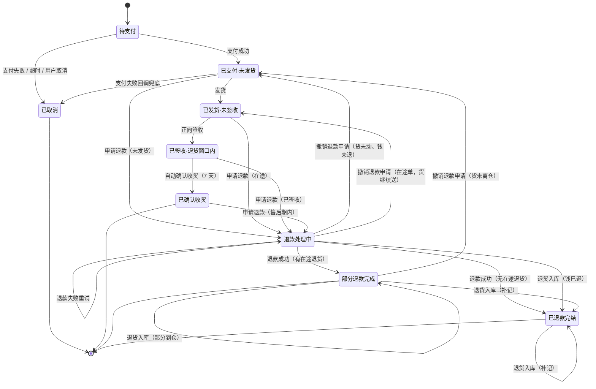

# 订单状态机（Order State Machine）

> 阶段 0 · D2 产出物
>
> **本文档是订单状态的唯一真相源。** 合法转移只在这里定义一次，代码里的状态机模块必须与本文逐行对应。
> DoD #3（回调幂等 / 乱序回调不破坏状态机）能否通过，取决于本文有没有定义清楚的「每个事件只生效一次」机制。
>
> 上游：`01-usecases.md`（六个用例的分支表） · 下游：`02-api-contract.md`（错误码）、`03-dod.md`（表字段草案）

## 1. 状态转移图

> **图里三个容易看漏的地方**
>
> 1. **`REFUNDING` 有两条边指向 `REFUNDED`**：「退款成功」（支付方回调）和「退货入库」（货到仓）。两条边的**触发源不同、库存动作不同**，但都是同一个终态的合法入口 —— 实现时必须都覆盖，不能只做支付方回调那一条。
> 2. **三个「补记库存」自环**：`REFUNDED → REFUNDED`、`PARTIALLY_REFUNDED → PARTIALLY_REFUNDED`，加上 `REFUNDING → REFUNDING`（退款失败重试，不涉库存）。自环存在的唯一原因是「钱退了、货还在路上」，到仓时必须补记库存，而订单已经是终态/半终态、不能再变。自环是这里唯一正确的表达 —— 状态不变，库存照记。
> 3. **三条「往回走」的边（撤销退款申请）**：`REFUNDING → PAID`、`REFUNDING → SHIPPED`、`PARTIALLY_REFUNDED → PAID`。它们指向的是**申请退款之前的那个状态**，不是固定终点 —— 具体回哪个由 `order_items.refund_from_status` 决定（见 T18）。图里逐条画出是因为 Mermaid 无法表达「回原状态」这种动态终点。

## 2. 状态集合

| 状态 | 含义 | 库存挂账位置 | 类型 |
| --- | --- | --- | --- |
| `PENDING_PAYMENT` | 已创建，等待支付 | `reserved` | 存活态 |
| `PAID` | 已付款，未发货 | `reserved` | 存活态 |
| `SHIPPED` | 已发货，未签收（含正向在途、在驿站） | `in_transit` | 存活态 |
| `DELIVERED` | 已签收，未确认收货（退货窗口内） | 不在四栏（已交付用户） | 存活态 |
| `COMPLETED` | 已确认收货，交易完结 | 不在四栏 | **终态** |
| `REFUNDING` | 退款/退货处理中（钱可能已退，货可能没回） | 依申请时状态而定 | 存活态（**可撤销**） |
| `PARTIALLY_REFUNDED` | 申请退的项货还没回仓，钱已退 | 未退项在四栏，退的项在 `in_transit` | **半终态**：只能收尾，不能发起新的钱货动作 |
| `REFUNDED` | 已退款完结 | 通常不在四栏 | **终态**（允许库存继续变动的终态） |
| `CANCELLED` | 已取消（从未成交） | — | **终态** |

**六个关键区分**

1. **`CANCELLED` = 钱没收到的退出**（支付失败 / 超时 / 未支付时用户取消）；**`REFUNDED` = 钱收了又退的退出**。两者不可互换，也不可在状态间直接跳。
2. **`DELIVERED` 与 `COMPLETED` 之间隔着 7 天**，这 7 天就是退货窗口。`DELIVERED` 必须存在，否则「已签收但未过退货期」没有状态可表达。
3. **`DELIVERED` / `COMPLETED` 的货不在四栏库存里** —— 已交付用户，离开 INV-2 恒等式（见 `01-usecases.md`）。
4. **`REFUNDED` 与 `PARTIALLY_REFUNDED` 是仅有的两个「已收尾但库存仍会变动」的状态**（退货在途场景），这是 INV-7 的明文例外。
5. **`PARTIALLY_REFUNDED` 是半终态**：它意味着「钱已经退给用户，但货还在路上」。常规出口是 `REFUNDED`（货到仓后收尾）—— 因为钱已经出去了，这一般不可逆；唯一例外是「货从未离仓且能重新预占成功」时允许撤销（T18b，钱会以 `REVOKED` 留在 `refunds` 里，不会消失）。除此之外不接受任何新动作。
6. **`REFUNDING` 与 `PARTIALLY_REFUNDED` 都可撤销**（T18/T18a/T18b）：只要**钱还没退出去**且**货未到仓**（`PARTIALLY_REFUNDED` 额外要求货从未离仓），用户就能撤销退款申请。撤销的终点不是固定状态，而是 `order_items.refund_from_status` 记录的「申请退款之前的状态」。

### `order_items.refund_status` 取值

| 取值 | 含义 | 钱的状态 | 可否再次申请退款 |
| --- | --- | --- | --- |
| `NONE` | 无退款 | — | 可以 |
| `REFUNDING` | 退款在途 | 未退出或已发出 | 否 |
| `REFUNDED` | 退款完成 | 已退出且货已归位 | 否 |
| `REVOKED` | 撤销成功但**钱曾发出过** | 已发出、结果待人工确认 | 允许（但会命中【需人工介入】#1） |

> **为什么撤销要区分 `NONE` 和 `REVOKED`**：`refunds.status IN ('PENDING','CREATED')` 意味着钱从未离开我方，撤销后干净地回到 `NONE`；而 `SENT` 意味着支付方可能已经把钱退给用户了 —— 这时状态能回到申请前，但**「钱曾发出过」这个事实不能丢**，必须留在 `refunds` 表里并打【需人工介入】#1 标注。丢掉它就会变成「系统认为没退过款，用户却收到了钱」。

### 订单状态如何由订单项聚合而来

退款粒度在 `order_items.refund_status`（决策 I），订单级状态由它聚合：

| 订单项 `refund_status` 分布 | 订单级状态 | 说明 |
| --- | --- | --- |
| 全部 `NONE`（或 `REVOKED`） | 保持 `PAID` / `SHIPPED` / `DELIVERED` / `COMPLETED` | 无在途退款（`REVOKED` 只说明「曾申请过」，不构成退款状态） |
| 存在 `REFUNDING` 项，且**钱尚未退出** | `REFUNDING` | 退款处理中，$0 已退 |
| 存在 `REFUNDED` 项（钱已退），且退款项**货未回仓** | `PARTIALLY_REFUNDED` | 钱已退、货在路上 |
| 全部项 `REFUNDING`，且**钱已退出** | `REFUNDING` | 整单在退 |
| 全部项 `REFUNDED` | `REFUNDED` | 整单退完 |
| `REFUNDING` + `NONE` 混合（部分退） | `PARTIALLY_REFUNDED` | v1 不会出现 |

> **关键区分**：`REFUNDING` 与 `PARTIALLY_REFUNDED` 的分界不是「退了几项」，而是**「钱退出去了没有」**。钱还在我方 → `REFUNDING`（可撤销）；钱已到用户那儿 → `PARTIALLY_REFUNDED`（不可逆，只能等货回仓）。

> **v1 的约束**：所有项必须一起退（`PARTIAL_REFUND_NOT_SUPPORTED`），所以 v1 里 `PARTIALLY_REFUNDED` **只会由「钱先到、货在途」这一条路径进入**，不会由部分退货进入。它现在就建好，是为了让「放开部分退货」变成删一行校验，而不是改状态机。

## 3. 事件清单与触发源

状态机只认事件，不认调用方。任何事件都必须走同一套转移规则。

| 事件 | 触发者 | 载体 | 可能来源 |
| --- | --- | --- | --- |
| `ORDER_CREATED` | 用户 | `POST /orders` | 前端 |
| `PAYMENT_SUCCEEDED` | 支付方 | `POST /payments/callback/{provider}` | 支付方推送（或 `mock-success`） |
| `PAYMENT_FAILED` | 支付方 | 同上 | 支付方推送 |
| `PAYMENT_TIMEOUT` | 延迟队列 / 调度器 | 内部 | 延迟队列到期、扫描兜底 |
| `USER_CANCELLED` | 用户 | `POST /orders/cancel/{id}` | 前端 |
| `SHIP_REQUESTED` | 调度器 / 管理员 | 内部 / `POST /admin/orders/ship/{id}` | 自动发货任务、后台操作 |
| `DELIVERY_CONFIRMED` | 调度器 / 管理员 | 内部 / `POST /admin/orders/deliver/{id}` | 自动签收任务、后台操作 |
| `ORDER_AUTO_COMPLETED` | 调度器 | 内部 | 确认收货任务 |
| `REFUND_REQUESTED` | 用户 / 客服 | `POST /orders/refund/{id}` | 前端 |
| `REFUND_CONFIRMED` | 支付方 | 支付方退款回调 | 支付方推送 |
| `REFUND_FAILED` | 支付方 | 同上 | 支付方推送 |
| `REFUND_REVOKED` | 用户 / 客服 | `POST /orders/refund-revoke/{id}` | 前端 |
| `RETURN_RECEIVED` | 调度器 / 管理员 | 内部 / `POST /admin/orders/return-received/{id}` | 退货入库任务、后台操作 |

> **`DELIVERY_CONFIRMED` 语义说明**：它表示「包裹已送达并被签收」，**不区分用户是收下还是拒收**。拒收场景走 `SHIPPED → DELIVERED → REFUNDING → REFUNDED`，比现实多绕一步，但保证货权先归用户、再走退货 —— 这样所有退货场景共用同一条路径，不需要为拒收单独开一条边。

## 4. 转移表（唯一真相源）

**图例**：`意图` = 调用方想做什么（可能被拒）；`生效条件` = 数据库 `WHERE` 子句；`库存动作` 与状态变更同一事务。

**两条全局约定**（表中不再重复）：

1. **`n` 的含义**：本**次操作范围内**的订单项数量合计 —— 下单时是本次要预占的量，退款时是本次要归还的量，签收时是**本次到仓的包裹**里的量（一个包裹可能只含部分订单项）。
2. **申请退款的四项（T7 / T10 / T12 / T13）额外带一个前置**：`order_items.refund_status IN ('NONE','REVOKED') AND refunds.status NOT IN ('PENDING','CREATED')` —— 防止在已有在途退款、或刚撤销又重放的情况下重复发起。

| # | 从 → 到 | 事件 | 意图 | 生效条件（WHERE） | 库存动作 | 幂等机制 |
| --- | --- | --- | --- | --- | --- | --- |
| T1 | `[*]` → `PENDING_PAYMENT` | `ORDER_CREATED` | 创建订单 | `available >= n`（预占） | `available -= n`，`reserved += n` | `idempotency_keys` 唯一约束 |
| T2 | `PENDING_PAYMENT` → `PAID` | `PAYMENT_SUCCEEDED` | 标记已支付 | `status='PENDING_PAYMENT'` | 无 | `payment_events.event_id` 唯一约束 |
| T3 | `PENDING_PAYMENT` → `CANCELLED` | `PAYMENT_FAILED` | 取消订单 | `status='PENDING_PAYMENT'` | `reserved -= n`，`available += n` | 同 T2 + 条件更新 |
| T4 | `PENDING_PAYMENT` → `CANCELLED` | `PAYMENT_TIMEOUT` | 取消订单 | `status='PENDING_PAYMENT'` | 同 T3 | 条件更新（延迟队列 + 扫描天然重复触发） |
| T5 | `PENDING_PAYMENT` → `CANCELLED` | `USER_CANCELLED` | 取消订单 | `status='PENDING_PAYMENT' AND user_id=?` | 同 T3 | 条件更新 |
| T6 | `PAID` → `SHIPPED` | `SHIP_REQUESTED` | 发货 | `status='PAID'` | `reserved -= n`，`in_transit += n` | 条件更新（自动 + 手动双触发） |
| T7 | `PAID` → `REFUNDING` | `REFUND_REQUESTED` | 申请退款 | `status='PAID' AND refund_status='NONE'` | `reserved -= n`，`available += n`（货没动过） | `order_items.refund_status` 前置 + 条件更新 |
| T8 | `PAID` → `CANCELLED` | `PAYMENT_FAILED` | 兜底取消 | `status='PAID'` | 同 T3 | 条件更新（异步回调晚于发货场景） |
| T9 | `SHIPPED` → `DELIVERED` | `DELIVERY_CONFIRMED` | **正向签收**（货权归用户） | `status='SHIPPED'` | `in_transit -= n`，**货离开四栏** | 条件更新 |
| T10 | `SHIPPED` → `REFUNDING` | `REFUND_REQUESTED` | 申请退款 | `status='SHIPPED'` | **不动**（货在途） | 条件更新 |
| T11 | `DELIVERED` → `COMPLETED` | `ORDER_AUTO_COMPLETED` | 确认收货 | `status='DELIVERED'` | 无 | 条件更新 |
| T12 | `DELIVERED` → `REFUNDING` | `REFUND_REQUESTED` | 申请退款 | `status='DELIVERED'` | **不动**（货在用户手上） | 条件更新 |
| T13 | `COMPLETED` → `REFUNDING` | `REFUND_REQUESTED` | 售后退款 | `status='COMPLETED'` | **不动** | 条件更新 |
| T14 | `REFUNDING` → `REFUNDED` | `REFUND_CONFIRMED` | 退款成功，**钱货两清** | `status='REFUNDING' AND 无在途退货` | 无（T7 已归还；T10/T12/T13 待退货入库） | 条件更新 + `refunds` 唯一约束 |
| T14a | `REFUNDING` → `PARTIALLY_REFUNDED` | `REFUND_CONFIRMED` | 退款成功，**钱已退但货仍在途** | `status='REFUNDING' AND 存在在途退货项` | 无（待退货入库） | 同上 |
| T15 | `REFUNDING` → `REFUNDED` | `RETURN_RECEIVED` | 退货包裹入库（钱已退，全部项到齐） | `status='REFUNDING'` 且该单全部退货项的 `return_received_at` 已置位 | `in_transit -= n`，再 `available += n` 或 `damaged += n` | 条件更新 + `order_items.return_received_at` |
| T15a | `REFUNDING` → `PARTIALLY_REFUNDED` | `RETURN_RECEIVED` | 退货包裹入库（钱已退，**仍有项在途**） | `status='REFUNDING'` 且仍有退货项的 `return_received_at IS NULL` | 同 T15（只对本次到仓的项） | 同上 |
| T16 | `REFUNDED` → `REFUNDED` | `RETURN_RECEIVED` | 退货入库补记（钱先到、货后到） | `status='REFUNDED'` 且该单某项 `return_received_at IS NULL` | 同 T15 | 该项 `return_received_at IS NULL` 前置 |
| T16a | `PARTIALLY_REFUNDED` → `PARTIALLY_REFUNDED` | `RETURN_RECEIVED` | 退货入库补记（**仍有项在途**） | `status='PARTIALLY_REFUNDED'` 且仍有项 `return_received_at IS NULL` | 同 T15 | 同上 |
| T16b | `PARTIALLY_REFUNDED` → `REFUNDED` | `RETURN_RECEIVED` | 退货入库补记（**最后一项到齐**） | `status='PARTIALLY_REFUNDED'` 且全部退货项已到齐 | 同 T15 | 同上 |
| T17 | `REFUNDING` → `REFUNDING` | `REFUND_FAILED` | 退款失败，可重试 | `status='REFUNDING'` | 无 | `refunds.attempt_count` 自增 |
| T18 | `REFUNDING` → `PAID` | `REFUND_REVOKED` | 撤销退款申请（**货未动过**） | `status='REFUNDING'` 且 `refund_from_status='PAID'` 且 `refunds.status IN ('PENDING','CREATED')` 且无 `refund_shipped_at` | **反向预占**：`available -= n`，`reserved += n`（与 T7 严格互逆） | 条件更新 + `refunds.status` 前置 |
| T18a | `REFUNDING` → `SHIPPED` | `REFUND_REVOKED` | 撤销退款申请（**在途单，货继续送**） | `status='REFUNDING'` 且 `refund_from_status='SHIPPED'` 且 `refunds.status IN ('PENDING','CREATED')` | 无（货在途，维持 `in_transit`） | 同上 |
| T18b | `REFUNDING` / `PARTIALLY_REFUNDED` → `PAID` | `REFUND_REVOKED` | 撤销（钱已退但货未离仓 → 退钱需人工） | 同上 + 货从未离仓（无 `refund_shipped_at`、无 `return_received_at`） | 反向预占：`available -= n`，`reserved += n` | 同上 + **重新预占失败即整体回滚** |

**T18/T18a/T18b：撤销退款申请的判定轴**

撤销的**终点不固定**，取决于申请退款之前订单处于什么状态 —— 所以申请时必须把原状态记在 `order_items.refund_from_status`，否则无法回退。撤销要同时满足两个硬条件：

| 条件 | 为什么 |
| --- | --- |
| **钱还没退出去**：`refunds.status IN ('PENDING','CREATED')` | 钱一旦退出（`SENT`），撤销就变成「再收一次钱」，属于【需人工介入】，系统不做 |
| **货没到仓**：无 `return_received_at` | 货已经入库（甚至验货完毕），撤销要重新出库，库存语义与实物位置会脱节 |

| 申请时状态 | 撤销终点 | 库存动作 |
| --- | --- | --- |
| `PAID`（未发货）→ T18 | `PAID` | **反向预占** `available → reserved`，与 T7 严格互逆 |
| `SHIPPED`（在途）→ T18a | `SHIPPED` | 无（货继续送往用户） |
| `DELIVERED` / `COMPLETED`（已签收） | **不允许撤销** →【需人工介入】 | 货已在用户手上，退货动作已经发生 |
| 整单场景、货未离仓 → T18b | `PAID` | 反向预占 |

**反向预占可能失败**：撤销时库存可能已被别人买走（`available < n`）。此时**整个撤销操作回滚**，订单保持 `REFUNDING`，返回 `409 REFUND_REVOKE_STOCK_UNAVAILABLE`。绝不允许把 `available` 扣成负数（INV-1），也不允许「状态退了但库存没退」的中间态。

> **钱已退之后的撤销 = 人工介入**：若 `refunds.status = 'SENT'`，撤销在系统层面被拒，打【需人工介入】标注（见第 10 节）。v1 不做任何自动化处理。

**T14/T14a 与 T15/T15a/T16/T16a/T16b 是同一条业务的两种到达顺序**

同一条业务边「退款 + 退货」，因为「钱到账」和「货到仓」两个事实可能以任意顺序到达，被拆成多条边。判定的唯一轴是**「退款项是否还有在途的」**：

| 到达顺序 | 钱到账时 | 货到仓时 | 走哪条边 |
| --- | --- | --- | --- |
| 钱先到、货全在途 | `REFUNDING` | 尚未到 | **T14a** → `PARTIALLY_REFUNDED` |
| 钱先到、货后到 | `PARTIALLY_REFUNDED` | 部分到 → 仍有在途 | **T16a** 自环（补记库存） |
| 钱先到、货后到齐 | `PARTIALLY_REFUNDED` | 最后一项到 | **T16b** → `REFUNDED` |
| 钱先到、无退货在途（如发货前退款） | `REFUNDING` | 无需到仓 | **T14** → `REFUNDED` |
| 货先到、钱已退 | `REFUNDING` | 全部项到齐 | **T15** → `REFUNDED` |
| 货先到、仍有项在途 | `REFUNDING` | 部分到 | **T15a** → `PARTIALLY_REFUNDED` |
| 钱在货之后到（货已先入终态） | `REFUNDED` | 已到 | **T16** 自环（补记库存） |

**所有边都必须实现**，否则会漏掉一半场景。特别注意：T16/T16a 是**自环** —— 状态不变、只补记库存，因为订单此时已经收尾，但货还在路上，不补记就会违反 INV-7（状态与库存脱节）。

在货先到、钱后到的情况下，T14/T14a 的生效条件 `status='REFUNDING'` **不命中**，因此状态不变、库存不重复归还，但 `refunds.status` / `payments` 等非状态字段**照常补齐**（这部分不是状态流转，不违反 INV-6）。

## 5. 被拒绝的转移（必须显式报错）

| 意图 | 从 | 结果 | 错误码 |
| --- | --- | --- | --- |
| 用户取消 | `PAID` / `SHIPPED` / `DELIVERED` | 拒绝 —— 钱已收，只能走退款 | `409 ORDER_NOT_CANCELLABLE` |
| 用户取消 | 终态 | 拒绝 | `409 ORDER_ALREADY_FINAL` |
| 申请退款 | `PENDING_PAYMENT` | 拒绝 —— 钱没收到，无可退 | `409 ORDER_NOT_REFUNDABLE` |
| 申请退款 | `REFUNDING` / `REFUNDED` / `PARTIALLY_REFUNDED` | 拒绝 —— 已有在途退款 | `409 REFUND_ALREADY_REQUESTED` |
| 申请退款 | `CANCELLED` | 拒绝 | `409 ORDER_NOT_REFUNDABLE` |
| 申请退款 | 部分订单项 | 拒绝 —— v1 只支持整单退 | `400 PARTIAL_REFUND_NOT_SUPPORTED` |
| 撤销退款 | 钱已退出（`refunds.status='SENT'`） | 拒绝 +【需人工介入】 | `409 REFUND_ALREADY_SENT` |
| 撤销退款 | 货已到仓（有 `return_received_at`） | 拒绝 +【需人工介入】 | `409 RETURN_ALREADY_RECEIVED` |
| 撤销退款 | 申请时是 `DELIVERED` / `COMPLETED` | 拒绝 +【需人工介入】 | `409 REFUND_NOT_REVOCABLE_SIGNED` |
| 撤销退款 | 反向预占库存不足 | 拒绝，**整个操作回滚**，保持 `REFUNDING` | `409 REFUND_REVOKE_STOCK_UNAVAILABLE` |
| 发货 | `SHIPPED` / `DELIVERED` / 终态 | 拒绝（自动任务静默退出，手动调用报错） | `409 INVALID_STATE_TRANSITION` |
| 签收 | 非 `SHIPPED` | 静默退出（自动） / `409`（手动） | `409 INVALID_STATE_TRANSITION` |
| 任何事件 | 终态 / 半终态（`PARTIALLY_REFUNDED`） | 拒绝 —— INV-6 | `409 ORDER_ALREADY_FINAL`（回调类事件返回 200 + 落 `IGNORED`，不对支付方报错） |

> **对支付方与对用户要区别对待**：支付方的回调即使状态不匹配也必须返回 200（否则会被无限重推），差异记录在 `payment_events.status = IGNORED`；对用户的手动操作才返回 409。

## 6. 幂等：三道闸门

DoD #3 与 #4 全部依赖这三道闸门。**任何状态转移都必须同时受它们保护。**

| 闸门 | 机制 | 拦住的重复 | 对应转移 |
| --- | --- | --- | --- |
| 闸门 1 · 请求级 | `idempotency_keys` 表（`key` 唯一 + 请求指纹） | 用户重复提交下单 | T1 |
| 闸门 2 · 事件级 | `payment_events.event_id` 唯一约束（`ON CONFLICT DO NOTHING`） | 支付方重放回调 | T2、T3、T8、T14、T14a、T17 |
| 闸门 3 · 状态级 | **条件更新**：`UPDATE ... WHERE id=? AND status='期望状态'`，靠影响行数判断自己是否赢家 | 所有并发触发（队列 + 扫描 + 用户 + 调度器） | **全部 T1–T18b**（24 条边，无例外） |

> **闸门 3 是最后一道、也是最关键的一道**。即使闸门 1、2 全被绕过（例如同一条业务边被两个不同触发源唤起 —— 延迟队列与扫描兜底、自动发货与手动发货），条件更新仍能保证只有一个生效、库存只动一次。
>
> **禁止的写法**：`SELECT` 出状态 → 在应用层判断 → `UPDATE`。这在并发下会重复执行库存动作，直接破坏 INV-1。

## 7. 状态迁移的副作用清单

每个转移在**同一数据库事务**内必须完成：

| 转移 | 同事务写 | 提交后异步做 |
| --- | --- | --- |
| T1 | `orders` + `order_items` + `stock` + `idempotency_keys` | 写 `order_status` 缓存、入延迟队列（超时） |
| T2 | `orders.paid_at` + `payments` + `payment_events.status` | 更新缓存、**移出延迟队列**、按 `AUTO_SHIP_DELAY` 入队 |
| T3 / T4 / T5 / T8 | `orders` + `stock` + `payment_events`（T3/T8） | 更新缓存、移出队列 |
| T6 | `orders.shipped_at/expected_delivered_at` + `stock` | 更新缓存、按 `expected_delivered_at` 入队 |
| T7 | `orders` + `order_items.refund_status` + `refunds` + `stock` | 更新缓存、移出队列、调支付方退款 API |
| T9 | `orders.delivered_at` + `order_items.delivered_at` + `stock` | 更新缓存、移出队列 |
| T10 / T12 / T13 | `orders.refund_requested_at` + `order_items.refund_status` + `refunds` | 调支付方退款 API |
| T11 | `orders` | 更新缓存 |
| T14 / T14a | `orders` + `refunds.status` + `order_items.refund_status` | 更新缓存 |
| T15 / T15a / T16 / T16a / T16b | `orders` + `order_items.return_*` + `stock` | 更新缓存 |
| T17 | `refunds.attempt_count` + `last_error` | 退避重试入队、连续失败 N 次告警【需人工介入】 |
| T18 / T18a / T18b | `orders`（回 `refund_from_status`）+ `order_items.refund_status`（钱未曾发出 → `'NONE'`；**钱曾发出过 → `'REVOKED'`**）+ `refunds.status='REVOKED'` + `stock`（仅 T18/T18b 反向预占） | 更新缓存、**取消支付方的退款请求**（若其接口支持） |

**跨表铁律**：`orders.status` 与 `stock` 的变更**永远在同一事务**。任何「先改状态、之后异步补库存」的设计都会产生 INV-7 违反（状态与库存脱节）。

## 8. 实现映射（Rust 侧约定）

`crates/domain/state_machine/` 是唯一真相源，建议形状：

- **状态与事件用枚举**，不用字符串：`enum OrderStatus { PendingPayment, Paid, Shipped, Delivered, Completed, Refunding, PartiallyRefunded, Refunded, Cancelled }`（9 个），`enum OrderEvent { ... }`（对应第 3 节 13 个事件，含 `REFUND_REVOKED`）
- **一个纯函数做判定**：`fn next_status(from: OrderStatus, event: OrderEvent) -> Option<OrderStatus>` —— 返回 `None` 即非法转移。**这是唯一可以写「合法转移」的地方**，Handler 与 Service 都不许自己判断状态
- **纯函数、零 I/O**：不依赖 `axum`、不依赖 `sqlx`，全部用表驱动单测覆盖（24 条边 + 第 5 节的拒绝清单，每条一个用例）
- **`WHERE` 子句由转移表生成**：条件更新的期望状态直接取自转移表的「生效条件」列，避免代码与文档分叉

> **签名上的一个坑**：`next_status` 只知道「当前状态 + 事件」，但 T14 与 T14a、T15 与 T15a、T16a 与 T16b 的分岔还取决于「退款项是否还有在途的」；T18 与 T18a 的分岔取决于「申请退款前是什么状态」。这些信息都不在 `OrderStatus` 里，所以状态机需要第二条输入 —— 建议把签名扩成 `fn next_status(from: OrderStatus, event: OrderEvent, ctx: TransitionCtx) -> Option<OrderStatus>`，其中 `TransitionCtx` 只携带**纯数据**：`pending_return_items: bool`、`refund_from_status: Option<OrderStatus>`、`refund_money_sent: bool`、`return_received: bool`（仍然零 I/O）。不要退化成在 Service 层用 `if` 判断终点状态，否则「合法转移只在一处定义」就破了。

这条设计直接服务 DoD #3：状态机不碰数据库，就能用穷举单测证明「任何非法事件都不会改变状态」，而不需要起 Postgres 做集成测试。

## 9. 已知缺口（v1 不实现，但需在设计上留位）

1. **退款失败的人工介入态**：v1 用自环 T17 + `refunds.attempt_count` 表达重试，不引入 `REFUND_MANUAL` 状态 —— 重试超限后打【需人工介入】标注（第 10 节 #2）。
2. **换货 / 维修**：与退货共用 `REFUNDING`？还是另开状态？v1 不支持，若做需在 D4 前决定是否增加 `EXCHANGING`。
3. **部分退货**：状态机侧**已就绪** —— `PARTIALLY_REFUNDED` 已定义，T14a / T15a / T16a / T16b 四条边已画出。v1 只需在校验层拒绝部分项（`PARTIAL_REFUND_NOT_SUPPORTED`），因此 `PARTIALLY_REFUNDED` 在 v1 里不会被进入。**放开部分退货 = 删掉那条校验**，状态机、库存语义、转移表都不用改。这条已从「待定问题」变为「已解决」。
4. **`DAMAGED` 库存的后续处置**：报废 / 维修 / 折价销售，v1 只记账，处置动作打【需人工介入】。
5. **`DELIVERED` 阶段的部分退款**：已签收的单部分退货，货在用户手里，`in_transit` 语义边界需要再确认（D4 定表结构时一并处理）。

## 10. 【需人工介入】场景清单

**本项目不实现任何人工介入功能** —— 没有后台工单、没有审批流、没有人工改状态的接口。本节的用途是：**凡系统无法自动自洽处理的情形，一律在此登记并打标注**，系统只负责**记录下来 + 告警**，处置留给人工（v1 即「人去看日志/看表然后手工处理」）。

全项目的文档与代码注释凡涉及下列情形，都必须带【需人工介入】标记。

| # | 场景 | 触发条件 | 系统行为（v1） | 人工要做什么 |
| --- | --- | --- | --- | --- |
| 1 | **退款已发出后用户反悔**（撤销退款失败） | 撤销时 `refunds.status='SENT'` | 拒绝（`409 REFUND_ALREADY_SENT`），订单保持 `REFUNDING`，记日志 + 告警 | 与用户协商：要么接受退款、要么用户重新下单 |
| 2 | **退款连续失败** | T17 重试超 `MAX_REFUND_RETRY`（建议 5 次） | 停止重试，`refunds.status='FAILED'`，订单保持 `REFUNDING`，告警 | 查支付方后台原因，手工补退 |
| 3 | **金额不符 / 疑似篡改** | 回调金额 ≠ 订单金额（`AMOUNT_MISMATCH`） | 状态零流转，事件落库，告警 | 核对支付方账单，决定是否人工入账 |
| 4 | **已取消订单收到延迟支付回调** | `CANCELLED` 后收到 `PAY_SUCCESS`（`LATE_CALLBACK`） | 状态零流转，落 `IGNORED`，告警 | 原路退款给用户 |
| 5 | **退货包裹超期未入库** | `REFUNDING` 超过 `AUTO_RETURN_DAYS`（建议 15 天）仍无 `return_received_at` | 保持 `REFUNDING`，告警 | 查物流、联系用户、决定是否放弃追货 |
| 6 | **退货验货不合格** | `return_condition='DAMAGED'` | 库存进 `damaged`，订单照常入 `REFUNDED`（钱照退） | 决定残次品处置（报废/折价） |
| 7 | **撤销退款时反向预占失败** | 撤销申请但库存已被买走 | 回滚，保持 `REFUNDING`，返回 `409 REFUND_REVOKE_STOCK_UNAVAILABLE` | 告知用户无货可留，建议接受退款 |
| 8 | **已签收订单申请撤销退款** | 申请时状态为 `DELIVERED` / `COMPLETED` | 拒绝（`409 REFUND_NOT_REVOCABLE_SIGNED`） | 判断货是否真的未寄出，人工决定 |
| 9 | **库存对账不平** | `available + reserved + in_transit + damaged` 穿仓或与累计入库不符（INV-1/INV-2 违反） | 对账任务告警，**不自动修正** | 查数据来源，人工平账 |
| 10 | **订单关键字段被手工拨坏** | 例如发货时 `reserved < n`（B5 分支） | 事务回滚 + 告警 | 直接改数据库修正 |
| 11 | **重复支付** | 同一订单收到两笔 `PAY_SUCCESS`（不同 `event_id`） | 第二笔落 `IGNORED`，告警 | 人工退还多收的一笔 |

> **设计原则**：这些场景的共同点是「系统的自动规则会得出错误结果，或无法得出唯一结果」。遇到它们时**宁可停在中间态 + 告警，也不要猜着往下走** —— 猜错的代价（错退钱、错扣库存）远高于停在中间态让人来看一眼。
>
> 这也是为什么 `REFUNDING` 必须是一个**可长时间停留**的状态：它同时承载「正在退」「退失败等人看」「等退货入库」三种情形。
