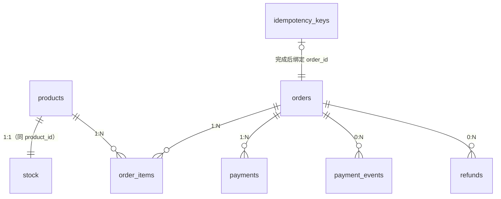

# 04 · DoD 验证方式、难点方案与表字段草案

> 阶段 0 · D4 产出物
>
> 上游：`01-usecases.md`（用例与不变量）、`02-state-machine.md`（状态与转移）、`03-api-contract.md`（错误码与常量）
> 下游：阶段 1（骨架与错误层）、阶段 3（SQLx 与迁移脚本）、W8（压测报告）
>
> 本文档回答三件事：**DoD 每一条怎么证明**、**三个难点用什么方案**、**数据库要有哪些字段**。

## 1. DoD 验证方式（九条）

原则：**每条 DoD 都要能用一条命令或一个脚本复现**，不接受「我看过了」。所有验证脚本最终落在 `benches/k6/` 与 `tests/` 下。

| # | 标准 | 验证方式（可执行） | 断言 | 主要卡点 |
| --- | --- | --- | --- | --- |
| 1 | 不超卖 | `k6 run benches/k6/seckill.js`（库存 100，1000 并发下单） | 成功响应恰 100；`stock.available = 0`；四栏全部 `>= 0`（INV-1）；四栏之和 = 初始入库（INV-2） | 扣减必须原子；条件更新而非先查后改 |
| 2 | 下单幂等 | 同一 `Idempotency-Key` 并发发 100 次 | 库里该 key 只有 1 行；`orders` 只多 1 条；100 个响应里首次 `201`、其余 `200` 且 `order_id` 相同 | 幂等表要有「请求指纹」，否则不同请求体也会被当成同一单 |
| 3 | 回调幂等 | 同一 `event_id` 重放 50 次；另跑乱序用例（`PAY_FAILED` 与 `PAY_SUCCESS` 颠倒、终态后补发） | `payment_events` 只有 1 行 `PROCESSED`，其余 `IGNORED`；订单状态只流转一次；50 个响应全部 `200` | 状态不匹配也必须返 200，否则支付方无限重推 |
| 4 | 超时取消 | 把 `expires_at` 拨到过去，等待一个 `SCAN_INTERVAL`；再重启服务重复一次 | 订单 `CANCELLED`；库存回到 `available`；重复触发只归还一次；重启后仍能取消 | 重启不丢靠**扫描兜底**，不靠队列可靠 |
| 5 | 契约完整 | `cargo run --bin export-openapi` + `npx openapi-typescript` | 生成 `docs/openapi.json` 与 `web/src/types/api.d.ts`；CI 里两者与入库版本 diff 为空 | `///` 没写全 → 生成的文档只有类型没有语义 |
| 6 | 可上线 | `just deploy`（或 `docker compose -f deploy/... up -d`）+ `curl https://<域名>/healthz` | 返回 200 且 `db`/`redis` 均为 `ok`；HTTPS 证书有效 | Nginx 反代 + 证书续期；环境变量与密钥注入 |
| 7 | 可观测 | `curl localhost:9090/metrics`，Grafana 看板截图 | 四项指标有数据：QPS、P99、下单成功率、**扣减冲突率** | 扣减冲突率需自定义指标，不是现成的 |
| 8 | 可恢复 | `pg_dump` 备份 → 灌到一个空库 → 跑对账 SQL | 备份耗时、恢复耗时、恢复后行数与校验和一致，全部记录在 `docs/reports/` | 恢复演练要**在空库上做**，不能覆盖原库 |
| 9 | 有沉淀 | 清点文件 | 12 篇 `journal/W*.md`；`notes/` 八个阶段均有内容；`docs/architecture.md`；`docs/reports/压测报告.md` | 每天必须有 commit 或笔记，否则不算完成 |

> **DoD #1 与 #4 是同一枚硬币的两面**：都靠「条件更新 + 同事务改库存」。做对一处，另一处基本免费。
>
> **DoD #7 的「扣减冲突率」要自己定义**：建议 `库存预占失败次数 / 库存预占尝试次数`，用计数器实现（不是直方图）。它是秒杀场景最能说明问题的指标 —— 成功率高说明库存充足，冲突率高说明在抢。

## 2. 难点方案假设

**本节只写假设**，实现选型在阶段 3（W4）定稿。每条都标注了「怎么证伪」。

### 2.1 不超卖（DoD #1）

| 层面 | 假设 | 怎么证伪 |
| --- | --- | --- |
| 数据库 | **单条 UPDATE 原子扣减**：`UPDATE stock SET available = available - $1, reserved = reserved + $1 WHERE product_id = $2 AND available >= $1`，靠影响行数判断成功 | 若出现 `available < 0` 即证伪（INV-1 被破坏） |
| 事务 | 扣减与写订单**同一事务**（`01-usecases.md` 用例 1 第 5–6 步） | 若出现「有订单但没扣库存」或反之，即证伪 |
| 并发 | 不依赖应用层锁、不依赖 Redis 预扣（v1 先不加），完全交给数据库行锁 + 条件更新 | 若必须加分布式锁才能不超卖，说明 SQL 写错了 |
| 压测 | k6 1000 并发抢 100 库存 | 成功数 ≠ 100 即证伪 |
| 兜底 | 加 `CHECK (available >= 0)` 等约束，让数据库自己拦 | 若日志里出现约束违反，说明应用层漏了判断 |

**预留的演进方向（不在 v1 做）**：Redis 预扣库存（`DECR` 返回负数即失败）把流量挡在数据库之前。这是 W6 缓存一致性的话题，**v1 故意不做** —— 先把数据库层的正确性钉死，再加缓存层，否则出问题时分不清是哪一层的错。

### 2.2 下单幂等（DoD #2）

| 层面 | 假设 | 怎么证伪 |
| --- | --- | --- |
| 键 | `Idempotency-Key` 请求头，UUID | — |
| 存储 | `idempotency_keys` 表，`key` 唯一约束 | 唯一约束缺失即证伪 |
| 指纹 | 存 `user_id` + `method` + `path` + **请求体哈希** | 若换请求体复用同一 key 却返回了首次结果，即证伪（那是串单，很危险） |
| 三态 | `IN_PROGRESS` → `COMPLETED`；并发时第二次请求看到 `IN_PROGRESS` 返回 `409 IDEMPOTENCY_IN_PROGRESS`（可重试） | 若并发 100 次出现两笔订单，即证伪 |
| 响应回放 | `COMPLETED` 时存**响应快照**，重试时原样回放（HTTP 200 而非 201） | 若重试返回的 `order_id` 与首次不同，即证伪 |
| 租户隔离 | 指纹里必须含 `user_id` | 若 A 用户能用 B 用户的 key 拿到 B 的订单，即证伪 |
| 过期 | `IDEMPOTENCY_TTL_HOURS`（默认 24），过期后同 key 可复用 | 清理任务要能跑通，且不会误删 `IN_PROGRESS` |

**顺序上的坑**：必须在**占位成功之后**才做下单逻辑。若先下单再写幂等表，并发下两次都过了占位检查，就会出两笔订单。

### 2.3 超时取消 / 回调幂等（DoD #3 #4）

两者共用同一套机制，合在一起说。

| 层面 | 假设 | 怎么证伪 |
| --- | --- | --- |
| 触发源 | 延迟队列（主通道，秒级）+ 到期扫描（兜底，`SCAN_INTERVAL` 默认 5 min） | 只做队列：重启后任务丢失即证伪；只做扫描：DoD #4 的「30 分钟内」精度不够 |
| 队列选型 | Redis ZSet，`member = order_id`，`score = expires_at`；取任务用 `ZRANGEBYSCORE ... LIMIT` + `ZREM` 原子弹 | 若同一订单被两个实例同时弹到并都处理，即证伪（此时靠条件更新兜住） |
| 幂等核心 | **条件更新** `WHERE status='PENDING_PAYMENT'`，靠影响行数判断赢家（`02-state-machine.md` 闸门 3） | 若库存被归还两次，即证伪 |
| 回调去重 | `payment_events.event_id` 唯一约束 + `ON CONFLICT DO NOTHING` | 若同一 `event_id` 两次都产生状态流转，即证伪 |
| 回调时序 | 三种 `result` 各自独立条件更新（见 `01-usecases.md` 用例 2 第 6 步） | 若乱序回调把订单推回错误状态，即证伪 |
| 对支付方 | 状态不匹配 / 订单不存在 / 金额不符**一律返回 200** | 若返回 4xx/5xx，支付方会无限重推，日志里能看到 |
| 队列丢失 | 扫描兜底必须能独立捞出到期订单（不依赖队列） | 手动清空 ZSet 后重启，订单仍应被取消 |

**Redis 与数据库的分工**：Redis 只做「什么时候该处理」的调度，**不参与正确性判断**。所有「能不能改」的判断都在数据库的条件更新里。这样 Redis 丢数据最多导致晚一点处理，不会导致处理错。

## 3. 表字段草案（八张表）

**为什么是八张**：前七张围绕订单，第八张 `products` 是商品主数据 —— 没有它，`order_items.product_id` 与 `stock.product_id` 就指向一个不存在的表，「商品存在且 `ON_SALE`」这个前置条件也无处可查。

| 表 | 粒度 | 职责 |
| --- | --- | --- |
| `products` | 一商品一行 | 商品主数据：名称、价格、是否在售 |
| `stock` | 一商品一行 | **只放数量**，四个库存栏 + 累计入库 |
| `orders` / `order_items` | 一单 / 一项 | 交易 |
| `payments` / `payment_events` | 一笔 / 一次回调 | 钱与回调幂等 |
| `refunds` | 一次退款 | 退款状态机 |
| `idempotency_keys` | 一个幂等键 | 请求幂等 |

> **`stock` 不是「订单下的库存表」**：它与订单没有从属关系，而是**按商品**记账（`product_id` 是主键）。订单只是「借走」了其中若干件，靠 `order_items` 记录借了多少。

**通用约定**

- 主键：`id BIGSERIAL`（内部用）或 `UUID`（对外暴露，如订单/支付/退款）；两种都存在时，对外用 UUID、内部关联用 bigint
- 金额：**`BIGINT`，单位分**。禁用 `DECIMAL` 与浮点（`03-api-contract.md` §10）
- 时间：`TIMESTAMPTZ`，全部 UTC
- 状态与枚举：`TEXT` + `CHECK` 约束（不用 PostgreSQL `ENUM` 类型 —— 加值要改类型，迁移麻烦）
- 所有表带 `created_at` / `updated_at`
- 唯一约束的命名统一 `uq_<表>_<列>`，便于排障

### 3.1 `products` —— 商品主数据

| 列 | 类型 | 说明 |
| --- | --- | --- |
| `id` | `BIGINT PK` | 商品 ID，对外暴露（`GET /products` 用它） |
| `name` | `TEXT NOT NULL` | 商品名 |
| `status` | `TEXT NOT NULL` | `ON_SALE` / `OFF_SALE` —— **用例 1 的前置条件就是查这一列** |
| `price_cent` | `BIGINT NOT NULL` | 售价，单位分。`CHECK (price_cent >= 0)` |
| `created_at` / `updated_at` | `TIMESTAMPTZ NOT NULL` | — |

**索引**：`(status)`（商品列表默认只列在售）。
**两条硬纪律**：
1. **商品不上物理删除**，下架只改 `status = 'OFF_SALE'`。历史订单的展示与退款都依赖它存在。
2. **`price_cent` 可改，但只影响之后的新订单** —— 已成交订单的价格在下单那一刻就快照进 `order_items.unit_price`，改价不影响历史（`orders.total_amount` 也已经在当时算定）。

> **`GET /products` 为什么返回 `available`**：它需要 `products` 与 `stock` 两张表各取一部分（`products` 给名称与价格，`stock` 给可售数量）。契约见 `03-api-contract.md` §8.2。

### 3.2 `orders` —— 订单主表

| 列 | 类型 | 说明 |
| --- | --- | --- |
| `id` | `UUID PK` | 对外暴露的订单号 |
| `user_id` | `BIGINT NOT NULL` | 归属用户（鉴权 W5 落地） |
| `status` | `TEXT NOT NULL` | 9 个状态之一（类型名 `OrderStatus`），见 `02-state-machine.md` §2 |
| `total_amount` | `BIGINT NOT NULL` | = `Σ order_items.subtotal`（金额不变量） |
| `expires_at` | `TIMESTAMPTZ NOT NULL` | 支付截止，下单时 = now + `ORDER_TIMEOUT_MINUTES` |
| `auto_ship_at` | `TIMESTAMPTZ NULL` | 自动发货时刻，支付成功时 = `paid_at` + `AUTO_SHIP_DELAY_SECONDS` |
| `expected_delivered_at` | `TIMESTAMPTZ NULL` | 预计签收，发货时 = now + `AUTO_SIGN_DAYS` |
| `paid_at` / `shipped_at` / `delivered_at` / `completed_at` | `TIMESTAMPTZ NULL` | 各阶段时间戳 |
| `refund_requested_at` | `TIMESTAMPTZ NULL` | 申请退款时刻 |
| `cancelled_at` | `TIMESTAMPTZ NULL` | 取消时刻 |
| `cancel_reason` | `TEXT NULL` | `TIMEOUT` / `USER_CANCEL` / `USER_REFUND` / `PAY_FAILED` |

**索引**：`(user_id, created_at DESC)`（我的订单列表）；`(status, expires_at)`（超时扫描）；`(status, auto_ship_at)`（自动发货扫描）；`(status, expected_delivered_at)`（自动签收扫描）。
**约束**：`CHECK (total_amount >= 0)`；`CHECK (status IN (...9 个...))`。

### 3.3 `order_items` —— 订单项

| 列 | 类型 | 说明 |
| --- | --- | --- |
| `id` | `BIGSERIAL PK` | 内部主键 |
| `order_id` | `UUID NOT NULL REFERENCES orders(id)` | — |
| `product_id` | `BIGINT NOT NULL REFERENCES products(id) ON DELETE RESTRICT` | 商品 ID。**保留外键但禁止级联删除** —— 商品不允许物理删除（只能下架），外键防的是「stock 里挂了不存在的商品」 |
| `product_name` | `TEXT NOT NULL` | **价格与名称快照** —— 商品改名/下架不影响历史订单 |
| `unit_price` | `BIGINT NOT NULL` | 下单时的单价（分） |
| `quantity` | `INT NOT NULL` | `CHECK (quantity > 0)` |
| `subtotal` | `BIGINT NOT NULL` | = `unit_price * quantity` |
| `refund_status` | `TEXT NOT NULL DEFAULT 'NONE'` | `NONE` / `REFUNDING` / `REFUNDED` / `REVOKED`（类型名 `OrderItemRefundStatus`） |
| `refund_from_status` | `TEXT NULL` | **申请退款时的订单状态** —— 撤销靠它回退，不写就无法实现撤销 |
| `refund_shipped_at` | `TIMESTAMPTZ NULL` | 在途退款申请时刻（货已发出） |
| `return_received_at` | `TIMESTAMPTZ NULL` | 退货包裹入库时刻 —— 库存归还的触发点 |
| `return_condition` | `TEXT NULL` | `GOOD` / `DAMAGED`，决定库存回 `available` 还是 `damaged` |

**索引**：`(order_id)`；部分索引 `(order_id) WHERE refund_status <> 'NONE'`（退款排查用）。

### 3.4 `stock` —— 库存（**一商品一行，与订单无从属关系**）

| 列 | 类型 | 说明 |
| --- | --- | --- |
| `product_id` | `BIGINT PK REFERENCES products(id) ON DELETE RESTRICT` | **主键就是商品 ID** —— 一个商品只有一行库存 |
| `available` | `INT NOT NULL` | 可售 |
| `reserved` | `INT NOT NULL` | 已售未发 |
| `in_transit` | `INT NOT NULL` | 已发未签收（**退货包裹在途也算这里**） |
| `damaged` | `INT NOT NULL` | 验货不合格，不可售 |
| `total_inbound` | `INT NOT NULL` | **累计入库总量** —— 该商品历史上共有多少件进入过仓库，由种子数据或人工入库设定 |
| `sold` | **派生值，不建列** | 已正向签收交付用户的件数。由订单聚合得出（见下方 SQL），**不落库** —— 落库就要跟订单状态保持同步，属于重复真相源 |

**约束（关键）**：`CHECK (available >= 0)`、`CHECK (reserved >= 0)`、`CHECK (in_transit >= 0)`、`CHECK (damaged >= 0)` —— **让数据库自己兜住 INV-1**，应用层漏判也扣不出负数。
**`total_inbound` 的语义与对账**：它是**资产基线**，等于「还在我方手里的 + 已经卖出去的」：

```
available + reserved + in_transit + damaged + sold = total_inbound
```

其中 `sold` = 已经通过正向签收交付用户的件数，可由订单数据聚合：

```sql
SELECT COALESCE(SUM(oi.quantity), 0) FROM order_items oi
JOIN orders o ON o.id = oi.order_id
WHERE oi.product_id = $1 AND o.status IN ('DELIVERED','COMPLETED','REFUNDING','REFUNDED');
```

> **为什么 `sold` 要算进来**：正向签收后货已交付用户、**离开四栏**，四栏之和必然小于 `total_inbound`，差额就是已售出。所以对账等式必须含 `sold`，单看四栏会误判为「库存丢了」。
>
> **退货的两面**：退货包裹入库时 `in_transit → available`（四栏之和不变），而 `total_inbound` **也不变** —— 货本来就在账上，只是从「已售出」回到「可售」。这是 v1 的简化：`sold` 会因此变小，对账恒等式仍成立。

### 3.5 `payments` —— 支付流水

| 列 | 类型 | 说明 |
| --- | --- | --- |
| `id` | `UUID PK` | — |
| `order_id` | `UUID NOT NULL REFERENCES orders(id)` | — |
| `provider` | `TEXT NOT NULL` | 支付方标识 |
| `provider_txn_id` | `TEXT NULL` | 支付方流水号 |
| `amount` | `BIGINT NOT NULL` | 实收金额（分） |
| `status` | `TEXT NOT NULL` | `SUCCESS` / `FAILED` |

**索引**：`(order_id)`；唯一 `(provider, provider_txn_id)` —— 防同一笔支付被记两次。

### 3.6 `payment_events` —— 回调事件（幂等的关键表）

| 列 | 类型 | 说明 |
| --- | --- | --- |
| `id` | `BIGSERIAL PK` | — |
| `event_id` | `TEXT NOT NULL UNIQUE` | **支付方事件 ID，唯一约束就是闸门 2** |
| `provider` | `TEXT NOT NULL` | — |
| `order_id` | `UUID NULL REFERENCES orders(id) ON DELETE RESTRICT` | 允许为空：订单不存在的回调也要落库（记 `UNKNOWN_ORDER` + 告警），**不能因为找不到订单就把事实丢掉** |
| `result` | `TEXT NOT NULL` | `PAY_SUCCESS` / `PAY_FAILED` / `REFUND_SUCCESS` |
| `amount` | `BIGINT NULL` | 回调金额，用于比对 |
| `status` | `TEXT NOT NULL` | `PROCESSED` / `IGNORED` / `AMOUNT_MISMATCH` / `UNKNOWN_ORDER` |
| `status_before` / `status_after` | `TEXT NULL` | 状态流转前后值，排障用 |
| `ignore_reason` | `TEXT NULL` | 落 `IGNORED` 的原因（如 `LATE_CALLBACK`） |
| `occurred_at` | `TIMESTAMPTZ NOT NULL` | 支付方声明的事件时间 |
| `raw_body` | `JSONB NOT NULL` | 原始报文，验签与排障的最终依据 |

**索引**：`(order_id)`；`(status) WHERE status <> 'PROCESSED'`（**异常事件排查面板**，对应【需人工介入】场景）。

### 3.7 `refunds` —— 退款记录

| 列 | 类型 | 说明 |
| --- | --- | --- |
| `id` | `UUID PK` | 对外暴露的退款号 |
| `order_id` | `UUID NOT NULL REFERENCES orders(id)` | — |
| `amount` | `BIGINT NOT NULL` | 退款额（分） |
| `status` | `TEXT NOT NULL` | `PENDING` / `CREATED` / **`SENT`** / `SUCCESS` / `FAILED` / `REVOKED`（类型名 `RefundRecordStatus`，与订单项的 `OrderItemRefundStatus` **不得同名**） |
| `provider_refund_id` | `TEXT NULL` | 支付方退款单号 |
| `attempt_count` | `INT NOT NULL DEFAULT 0` | 重试次数，超 `MAX_REFUND_RETRY` 告警 |
| `last_error` | `TEXT NULL` | 最后一次失败原因 |
| `reason` | `TEXT NULL` | 用户填写的退款原因 |

**`SENT` 是关键分界**：撤销能否成功、`order_items.refund_status` 记 `NONE` 还是 `REVOKED`，全靠它（`02-state-machine.md` §2）。
**唯一约束**：同一 `order_id` 同时只允许一条非终态退款 —— 用部分唯一索引 `uq_refunds_active ON refunds(order_id) WHERE status IN ('PENDING','CREATED','SENT')`。

### 3.8 `idempotency_keys` —— 下单幂等表

| 列 | 类型 | 说明 |
| --- | --- | --- |
| `key` | `TEXT PK` | 客户端传来的 `Idempotency-Key` |
| `user_id` | `BIGINT NOT NULL` | **指纹的一部分**，防跨用户复用 key |
| `fingerprint` | `TEXT NOT NULL` | `method + path + body_hash`，用于识别「同 key 不同请求体」 |
| `status` | `TEXT NOT NULL` | `IN_PROGRESS` / `COMPLETED` |
| `order_id` | `UUID NULL` | 完成后绑定 |
| `response_snapshot` | `JSONB NULL` | 首次响应快照，重试时原样回放 |
| `expires_at` | `TIMESTAMPTZ NOT NULL` | now + `IDEMPOTENCY_TTL_HOURS` |

**索引**：`(expires_at)` 供清理任务；`key` 上的唯一约束即闸门 1。

### 3.9 表之间的关系



> **两处刻意的反范式，别在写迁移时「顺手修正」**：
>
> 1. **`order_items` 存 `product_name` 与 `unit_price` 快照** —— 商品改名或改价后，历史订单必须还能正确展示与退款。所以退款金额一律用快照算，**不 JOIN `products`**。
> 2. **`products` 与 `stock` 是两张表而不是一张** —— 商品主数据（名称/价格/在售状态）与库存数量（四栏 + 累计入库）的变更频率和变更原因完全不同：改价不该碰库存行，扣库存也不该锁价格。合表会让秒杀时的行锁竞争覆盖到商品信息上。

## 4. 交给阶段 3 的待办

1. **迁移脚本**：`migrations/0001_init.sql` 建这八张表 + 约束 + 索引。约束（`CHECK >= 0`、唯一索引、外键）要跟着迁移一起上，不要事后补。
2. **六个环境变量的落地**：`ORDER_TIMEOUT` / `AUTO_SHIP_DELAY` / `AUTO_SIGN_DAYS` / `COMPLETED_AFTER_DAYS` / `AUTO_RETURN_DAYS` / `SCAN_INTERVAL`，与 `03-api-contract.md` §7 的常量一一对应。
3. **对账 SQL** 两条，都作为 DoD #8 恢复演练的校验依据：
   - 库存两侧相等：`available + reserved + in_transit + damaged + sold = total_inbound`（`sold` 由订单聚合，见 §3.4）
   - 订单与库存占用相符：所有未取消订单的项数量之和 = `reserved`（单商品口径）
4. **`products` 的种子数据**：压测需要「库存 100 的商品」，所以 `0002_seed.sql` 要能插入商品 + 对应 `stock` 行（`total_inbound = 100`）。**这是 DoD #1 能跑起来的前提。**
5. **仍未定**：
   - `damaged` 库存的处置流程（报废 / 折价），v1 只记账 + 打【需人工介入】标注
   - `INTERCEPT_*` 字段是否需要建（第 2 路拦截只记录 `intercept_requested_at`）
   - 是否给 `orders` 加审计表 `order_events`（记录每次状态流转），或只依赖日志
   - **`total_inbound` 在真实入库流程里由谁维护** —— v1 没有采购/入库功能，它靠种子数据设定；将来若有入库单据，这里要变成「入库单汇总」而不是手工列
6. **一个设计假设需要验证**：v1 不引入 Redis 预扣库存，全靠数据库条件更新。**若 W8 压测发现数据库扛不住 1000 并发，再评估加预扣** —— 但那时要先证明「慢」而不是「错」。
