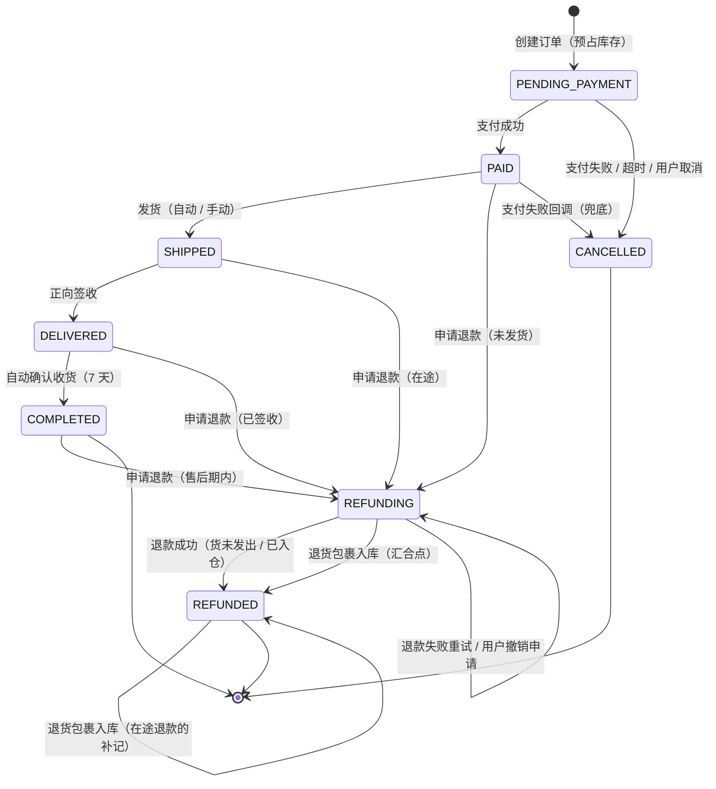

# 订单状态机（Order State Machine）

> 阶段 0 · D2 产出物
>
> **本文档是订单状态的唯一真相源。** 合法转移只在这里定义一次，代码里的状态机模块必须与本文逐行对应。
> DoD #3（回调幂等 / 乱序回调不破坏状态机）能否通过，取决于本文有没有定义清楚的「每个事件只生效一次」机制。
>
> 上游：`01-usecases.md`（五个用例的分支表） · 下游：`02-api-contract.md`（错误码）、`03-dod.md`（表字段草案）

## 1. 状态转移图

> **图中的两个汇合点**：`REFUNDING --> REFUNDED` 有两条边指向同一终点，分别代表「钱退成功」和「货到仓」。两条边的**触发源不同、库存动作不同**，但都是同一个终态的合法入口 —— 实现时必须都覆盖，不能只做支付方回调那一条。

## 2. 状态集合

| 状态 | 含义 | 库存挂账位置 | 类型 |
| --- | --- | --- | --- |
| `PENDING_PAYMENT` | 已创建，等待支付 | `reserved` | 存活态 |
| `PAID` | 已付款，未发货 | `reserved` | 存活态 |
| `SHIPPED` | 已发货，未签收（含正向在途、在驿站） | `in_transit` | 存活态 |
| `DELIVERED` | 已签收，未确认收货（退货窗口内） | 不在四栏（已交付用户） | 存活态 |
| `COMPLETED` | 已确认收货，交易完结 | 不在四栏 | **终态** |
| `REFUNDING` | 退款/退货处理中（钱可能已退，货可能没回） | 依申请时状态而定 | 存活态 |
| `REFUNDED` | 已退款完结 | 通常不在四栏 | **终态**（唯一允许库存继续变动的终态） |
| `CANCELLED` | 已取消（从未成交） | — | **终态** |

**四个关键区分**

1. **`CANCELLED` = 钱没收到的退出**（支付失败 / 超时 / 未支付时用户取消）；**`REFUNDED` = 钱收了又退的退出**。两者不可互换，也不可在状态间直接跳。
2. **`DELIVERED` 与 `COMPLETED` 之间隔着 7 天**，这 7 天就是退货窗口。`DELIVERED` 必须存在，否则「已签收但未过退货期」没有状态可表达。
3. **`DELIVERED` / `COMPLETED` 的货不在四栏库存里** —— 已交付用户，离开 INV-2 恒等式（见 `01-usecases.md`）。
4. **`REFUNDED` 是唯一可以「已终态、库存仍会变动」的状态**（在途退款场景下，货还在路上）。这是 INV-7 的明文例外。

## 3. 事件清单与触发源

状态机只认事件，不认调用方。任何事件都必须走同一套转移规则。

| 事件 | 触发者 | 载体 | 可能来源 |
| --- | --- | --- | --- |
| `ORDER_CREATED` | 用户 | `POST /orders` | 前端 |
| `PAYMENT_SUCCEEDED` | 支付方 | `POST /payments/callback/{provider}` | 支付方推送（或 `mock-success`） |
| `PAYMENT_FAILED` | 支付方 | 同上 | 支付方推送 |
| `PAYMENT_TIMEOUT` | 延迟队列 / 调度器 | 内部 | 延迟队列到期、扫描兜底 |
| `USER_CANCELLED` | 用户 | `POST /orders/cancel/{id}` | 前端 |
| `SHIP_REQUESTED` | 调度器 / 管理员 | 内部 / `POST /admin/orders/ship/{id}` | 自动发货任务、后台操作 |
| `DELIVERY_CONFIRMED` | 调度器 / 管理员 | 内部 / `POST /admin/orders/deliver/{id}` | 自动签收任务、后台操作 |
| `ORDER_AUTO_COMPLETED` | 调度器 | 内部 | 确认收货任务 |
| `REFUND_REQUESTED` | 用户 / 客服 | `POST /orders/refund/{id}` | 前端 |
| `REFUND_CONFIRMED` | 支付方 | 支付方退款回调 | 支付方推送 |
| `REFUND_FAILED` | 支付方 | 同上 | 支付方推送 |
| `RETURN_RECEIVED` | 调度器 / 管理员 | 内部 / `POST /admin/orders/return-received/{id}` | 退货入库任务、后台操作 |

> **`DELIVERY_CONFIRMED` 语义说明**：它表示「包裹已送达并被签收」，**不区分用户是收下还是拒收**。拒收场景走 `SHIPPED → DELIVERED → REFUNDING → REFUNDED`，比现实多绕一步，但保证货权先归用户、再走退货 —— 这样所有退货场景共用同一条路径，不需要为拒收单独开一条边。

## 4. 转移表（唯一真相源）

**图例**：`意图` = 调用方想做什么（可能被拒）；`生效条件` = 数据库 `WHERE` 子句；`库存动作` 与状态变更同一事务。

| # | 从 → 到 | 事件 | 意图 | 生效条件（WHERE） | 库存动作 | 幂等机制 |
| --- | --- | --- | --- | --- | --- | --- |
| T1 | `[*]` → `PENDING_PAYMENT` | `ORDER_CREATED` | 创建订单 | `available >= n`（预占） | `available -= n`，`reserved += n` | `idempotency_keys` 唯一约束 |
| T2 | `PENDING_PAYMENT` → `PAID` | `PAYMENT_SUCCEEDED` | 标记已支付 | `status='PENDING_PAYMENT'` | 无 | `payment_events.event_id` 唯一约束 |
| T3 | `PENDING_PAYMENT` → `CANCELLED` | `PAYMENT_FAILED` | 取消订单 | `status='PENDING_PAYMENT'` | `reserved -= n`，`available += n` | 同 T2 + 条件更新 |
| T4 | `PENDING_PAYMENT` → `CANCELLED` | `PAYMENT_TIMEOUT` | 取消订单 | `status='PENDING_PAYMENT'` | 同 T3 | 条件更新（延迟队列 + 扫描天然重复触发） |
| T5 | `PENDING_PAYMENT` → `CANCELLED` | `USER_CANCELLED` | 取消订单 | `status='PENDING_PAYMENT' AND user_id=?` | 同 T3 | 条件更新 |
| T6 | `PAID` → `SHIPPED` | `SHIP_REQUESTED` | 发货 | `status='PAID'` | `reserved -= n`，`in_transit += n` | 条件更新（自动 + 手动双触发） |
| T7 | `PAID` → `REFUNDING` | `REFUND_REQUESTED` | 申请退款 | `status='PAID' AND refund_status='NONE'` | `reserved -= n`，`available += n`（货没动过） | `order_items.refund_status` 前置 + 条件更新 |
| T8 | `PAID` → `CANCELLED` | `PAYMENT_FAILED` | 兜底取消 | `status='PAID'` | 同 T3 | 条件更新（异步回调晚于发货场景） |
| T9 | `SHIPPED` → `DELIVERED` | `DELIVERY_CONFIRMED` | **正向签收**（货权归用户） | `status='SHIPPED'` | `in_transit -= n`，**货离开四栏** | 条件更新 |
| T10 | `SHIPPED` → `REFUNDING` | `REFUND_REQUESTED` | 申请退款 | `status='SHIPPED'` | **不动**（货在途） | 条件更新 |
| T11 | `DELIVERED` → `COMPLETED` | `ORDER_AUTO_COMPLETED` | 确认收货 | `status='DELIVERED'` | 无 | 条件更新 |
| T12 | `DELIVERED` → `REFUNDING` | `REFUND_REQUESTED` | 申请退款 | `status='DELIVERED'` | **不动**（货在用户手上） | 条件更新 |
| T13 | `COMPLETED` → `REFUNDING` | `REFUND_REQUESTED` | 售后退款 | `status='COMPLETED'` | **不动** | 条件更新 |
| T14 | `REFUNDING` → `REFUNDED` | `REFUND_CONFIRMED` | 退款成功 | `status='REFUNDING'` | 无（T7 已归还；T10/T12/T13 待退货入库） | 条件更新 + `refunds` 唯一约束 |
| T15 | `REFUNDING` → `REFUNDED` | `RETURN_RECEIVED` | 退货包裹入库（钱已退） | `status='REFUNDING'` | `in_transit -= n`，再 `available += n` 或 `damaged += n` | 条件更新 + `order_items.return_received_at` |
| T16 | `REFUNDED` → `REFUNDED` | `RETURN_RECEIVED` | 退货包裹入库（在途退款的补记） | `status='REFUNDED' AND return_received_at IS NULL` | 同 T15 | `order_items.return_received_at IS NULL` 前置 |
| T17 | `REFUNDING` → `REFUNDING` | `REFUND_FAILED` | 退款失败，可重试 | `status='REFUNDING'` | 无 | `refunds.attempt_count` 自增 |

**T15 与 T16 是同一条业务边**：差别只在「钱退成功」和「货到仓」哪个先到。
- **钱先到**（T14 执行完）→ 走 T16：`orders.status` 不变（仍是 `REFUNDED`，T16 是自环），只补记库存。
- **货先到**（T15 执行完）→ 走 T15 时订单已入 `REFUNDED`；之后 T14 到达时它的生效条件 `status='REFUNDING'` **不命中**，因此**状态不变、不重复归还库存**，但 `refunds.status` / `payments` 等非状态字段**照常补齐**（这部分不是状态流转，不违反 INV-6）。

两条边都必须实现，否则会漏掉一半场景。

## 5. 被拒绝的转移（必须显式报错）

| 意图 | 从 | 结果 | 错误码 |
| --- | --- | --- | --- |
| 用户取消 | `PAID` / `SHIPPED` / `DELIVERED` | 拒绝 —— 钱已收，只能走退款 | `409 ORDER_NOT_CANCELLABLE` |
| 用户取消 | 终态 | 拒绝 | `409 ORDER_ALREADY_FINAL` |
| 申请退款 | `PENDING_PAYMENT` | 拒绝 —— 钱没收到，无可退 | `409 ORDER_NOT_REFUNDABLE` |
| 申请退款 | `REFUNDING` / `REFUNDED` | 拒绝 —— 已有在途退款 | `409 REFUND_ALREADY_REQUESTED` |
| 申请退款 | `CANCELLED` | 拒绝 | `409 ORDER_NOT_REFUNDABLE` |
| 申请退款 | 部分订单项 | 拒绝 —— v1 只支持整单退 | `400 PARTIAL_REFUND_NOT_SUPPORTED` |
| 发货 | `SHIPPED` / `DELIVERED` / 终态 | 拒绝（自动任务静默退出，手动调用报错） | `409 INVALID_STATE_TRANSITION` |
| 签收 | 非 `SHIPPED` | 静默退出（自动） / `409`（手动） | `409 INVALID_STATE_TRANSITION` |
| 任何事件 | 终态 | 拒绝 —— INV-6 | `409 ORDER_ALREADY_FINAL`（回调类事件返回 200 + 落 `IGNORED`，不对支付方报错） |

> **对支付方与对用户要区别对待**：支付方的回调即使状态不匹配也必须返回 200（否则会被无限重推），差异记录在 `payment_events.status = IGNORED`；对用户的手动操作才返回 409。

## 6. 幂等：三道闸门

DoD #3 与 #4 全部依赖这三道闸门。**任何状态转移都必须同时受它们保护。**

| 闸门 | 机制 | 拦住的重复 | 对应转移 |
| --- | --- | --- | --- |
| 闸门 1 · 请求级 | `idempotency_keys` 表（`key` 唯一 + 请求指纹） | 用户重复提交下单 | T1 |
| 闸门 2 · 事件级 | `payment_events.event_id` 唯一约束（`ON CONFLICT DO NOTHING`） | 支付方重放回调 | T2、T3、T8、T14、T17 |
| 闸门 3 · 状态级 | **条件更新**：`UPDATE ... WHERE id=? AND status='期望状态'`，靠影响行数判断自己是否赢家 | 所有并发触发（队列 + 扫描 + 用户 + 调度器） | **全部 T1–T17** |

> **闸门 3 是最后一道、也是最关键的一道**。即使闸门 1、2 全被绕过（例如同一条业务边被两个不同触发源唤起 —— 延迟队列与扫描兜底、自动发货与手动发货），条件更新仍能保证只有一个生效、库存只动一次。
>
> **禁止的写法**：`SELECT` 出状态 → 在应用层判断 → `UPDATE`。这在并发下会重复执行库存动作，直接破坏 INV-1。

## 7. 状态迁移的副作用清单

每个转移在**同一数据库事务**内必须完成：

| 转移 | 同事务写 | 提交后异步做 |
| --- | --- | --- |
| T1 | `orders` + `order_items` + `stock` + `idempotency_keys` | 写 `order_status` 缓存、入延迟队列（超时） |
| T2 | `orders.paid_at` + `payments` + `payment_events.status` | 更新缓存、**移出延迟队列**、按 `AUTO_SHIP_DELAY` 入队 |
| T3 / T4 / T5 / T8 | `orders` + `stock` + `payment_events`（T3/T8） | 更新缓存、移出队列 |
| T6 | `orders.shipped_at/expected_delivered_at` + `stock` | 更新缓存、按 `expected_delivered_at` 入队 |
| T7 | `orders` + `order_items.refund_status` + `refunds` + `stock` | 更新缓存、移出队列、调支付方退款 API |
| T9 | `orders.delivered_at` + `order_items.delivered_at` + `stock` | 更新缓存、移出队列 |
| T10 / T12 / T13 | `orders.refund_requested_at` + `order_items.refund_status` + `refunds` | 调支付方退款 API |
| T11 | `orders` | 更新缓存 |
| T14 | `orders` + `refunds.status` + `order_items.refund_status` | 更新缓存 |
| T15 / T16 | `orders` + `order_items.return_*` + `stock` | 更新缓存 |

**跨表铁律**：`orders.status` 与 `stock` 的变更**永远在同一事务**。任何「先改状态、之后异步补库存」的设计都会产生 INV-7 违反（状态与库存脱节）。

## 8. 实现映射（Rust 侧约定）

`crates/domain/state_machine/` 是唯一真相源，建议形状：

- **状态与事件用枚举**，不用字符串：`enum OrderStatus { PendingPayment, Paid, Shipped, Delivered, Completed, Refunding, Refunded, Cancelled }`，`enum OrderEvent { ... }`（对应第 3 节 12 个事件）
- **一个纯函数做判定**：`fn next_status(from: OrderStatus, event: OrderEvent) -> Option<OrderStatus>` —— 返回 `None` 即非法转移。**这是唯一可以写「合法转移」的地方**，Handler 与 Service 都不许自己判断状态
- **纯函数、零 I/O**：不依赖 `axum`、不依赖 `sqlx`，全部用表驱动单测覆盖（17 条边 + 第 5 节的拒绝清单，每条一个用例）
- **`WHERE` 子句由转移表生成**：条件更新的期望状态直接取自转移表的「生效条件」列，避免代码与文档分叉

这条设计直接服务 DoD #3：状态机不碰数据库，就能用穷举单测证明「任何非法事件都不会改变状态」，而不需要起 Postgres 做集成测试。

## 9. 已知缺口（v1 不实现，但需在设计上留位）

1. **撤销退款申请**：用户提交后反悔。真实业务有审批窗口，v1 一旦 `REFUNDING` 就不允许撤回。
2. **退款失败的人工介入态**：v1 用自环 T17 + `refunds.attempt_count` 表达重试，不引入 `REFUND_MANUAL` 状态。
3. **换货 / 维修**：与退货共用 `REFUNDING`？还是另开状态？v1 不支持，若做需在 D4 前决定是否增加 `EXCHANGING`。
4. **部分退货**：订单项级 `refund_status` 已支持，但缺少「部分项 REFUNDED、其余保持 COMPLETED」的订单级状态表达 —— 放开时可能需要 `PARTIALLY_REFUNDED`，这是 D4 定表结构前要确认的最后一个问题。
5. **`DAMAGED` 库存的后续处置**：报废 / 维修 / 折价销售，v1 只记账。
